<p align="center">
  
</p>

<h3 align="center">Your own team of AI bots that check each other’s work before saying “done”.</h3>

<p align="center">
  <a href="https://kwant.si">Website</a> ·
  <a href="https://kwant.si/docs/quickstart">Docs</a> ·
  <a href="https://kwant.si/features">Features</a> ·
  <a href="https://kwant.si/alternatives/grok-bot">Compare</a> ·
  <a href="CHANGELOG.md">Changelog</a> ·
  <a href="https://github.com/alexsergivan/kwant/discussions">Discussions</a>
</p>

<p align="center">
  <a href="https://github.com/alexsergivan/kwant/releases/latest/download/kwant_universal.dmg"></a>
  <a href="https://github.com/alexsergivan/kwant/releases/latest/download/kwant_amd64.deb"></a>
  <a href="https://github.com/alexsergivan/kwant/releases/latest/download/kwant_x86_64.AppImage"></a>
  <br>
  <sub>macOS: one app for Apple silicon and Intel · Linux x86_64 (beta): .deb or AppImage · A server: <a href="#self-hosting-on-a-vps">binary or Docker</a> · <a href="https://github.com/alexsergivan/kwant/releases/latest">All downloads</a></sub>
</p>

<p align="center">
  <a href="https://github.com/alexsergivan/kwant/stargazers"></a>
  <a href="https://github.com/alexsergivan/kwant/actions/workflows/ci.yml"></a>
  <a href="https://github.com/alexsergivan/kwant/releases/latest"></a>
  <a href="#license"></a>
  <br>
  <sub>Free and open source. A ⭐ helps others find kwant.</sub>
</p>

<p align="center"><b>kwant has no token.</b> Official X account is <a href="https://x.com/kwantbot">@kwantbot</a>.</p>

kwant gives you a team of bots that share chats, hand work to each other with an @mention and get it done on their own, on a schedule or while you're away. Each message goes to the bot that fits, and the reply says why. Work shows up as cards on a Mission board, and a task turns **Verified** only when kwant runs the check itself, never on a bot's word. Keep separate spaces for work and home, each with its own bots and accounts. Run it as an app on your Mac, Linux or Windows (beta) PC, or on a server, with the Claude, Codex or Grok CLI you already use, or your own API keys.

It's written in Rust (Tokio, Axum, SQLite) with a React web app embedded in the binary.

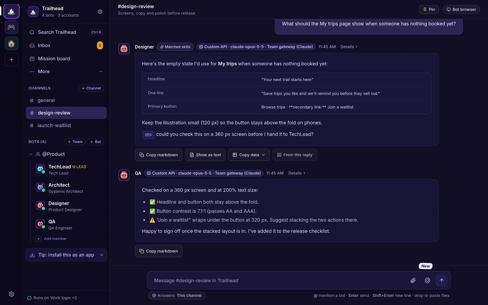

---

## New in 0.9

- **Review a bot's work in the Inbox** (0.9.0). Inbox › New has a **To review** group, highest risk first. Each item shows a verdict (Pass, Fail, Needs you or Not checked yet), what done looks like, the evidence, and a **Couldn't check** list with the reason for each. Press **Approve**, **Send back** with a note, or **Roll back**. Low-risk items that passed every check can be approved together with **Approve all**.
- **A second check before you approve** (0.9.0). When a Mission board task moves to review, a teammate on another model runs its checks again in a clean copy of the files and never writes to the task's folder. For high-risk work it also changes the code in small ways to see if the tests notice. It says Pass only when kwant ran a check again itself. A task can say what done means and what must not change, and rolling back work you approved moves the bot down one Flight School tier.
- **Point at the part of the page you mean** (0.9.0). In Watch live, press **Point** and click part of the page. The bot gets the page address, a selector, the element's HTML, its size and styles, and a picture of it. Point only reads the page: it never clicks or types.
- **Notes on diff lines, and CI back to the bot** (0.9.0). On a Dev desk review card, add notes on lines and send them to the bot as one message; after its next push, each note says whether those lines changed. Failed CI checks and review comments on a bot's PR go back to that bot as one Fix-it item, and when the PR goes green a fresh-eyes reviewer gives its advice. Nothing is posted to GitHub, and nothing is merged.
- **A worktree for each bot task** (0.9.0). The Dev desk's **Worktrees** tab makes a worktree from a new or existing branch, for a bot or just for you, and the bot works in its folder. **Remove** never deletes the branch and asks before it loses changes. An hour after a task finishes, kwant deletes build folders git ignores, such as `node_modules` and `target`, unless you keep them.
- **Watch a mission** (0.9.0). Pick a bot to check a mission's claims when it stops. A claim that doesn't hold sends its task back, and the report shows what was claimed and what was checked.
- **One order for what needs you** (0.9.0). The sidebar, the Inbox and the phone's Chats tab sort the same way: needs you, stuck or failed, to review, finished, working, waiting. A message to a busy or stuck bot is kept and says why it waits, and you get one notification when a turn shows no step for 15 minutes. Also: bots leave notes about their tools in Settings › Connections, and a bot can have a monthly budget (set through the API for now).
- **Fixed in 0.9.1.** Bots hand work to each other as often as the work needs, with no stop at 4 hand-offs to one teammate or 16 per message. Exact repeats and a teammate that failed 3 times in a row are skipped with the reason. You press **Continue** only after 64 hand-offs for one message. Hand-off cards catch up after a lost connection, and TikTok's QR sign-in no longer freezes the bot's browser.

0.8 added bots that show their work, approvals off reaching every engine, drag and drop into any chat, import from more places, fresh-eyes reviews with the pre-push card, and Claude kept away from your secrets on a Mac. Every change is in the [CHANGELOG](CHANGELOG.md).

---

## Why kwant

- **A team, not a chat tab.** Each bot has its own role, voice ("soul") and model. Bots @mention each other to hand work on, and a team lead runs short discussions and posts one summary. In a channel, kwant picks the bot that fits each message and shows why. The [Laya](#laya-model-router) router picks the model and effort for bots set to `auto`.
- **"Done" means checked.** The [Mission board](docs/mission-control.md) turns work into cards, one per hand-off. A card turns **Verified** only when kwant runs the check itself, such as a test or a file check, and the card keeps the receipt. Files a bot attaches are evidence to look at, never proof on their own.
- **Dev mode for code.** When bots write code, the [Dev desk](docs/dev-mode.md) shows what landed in each team's repo in plain words, and a bot that didn't write a pull request reviews it, tests and secrets included. Pushes to main, deploys and other production steps always ask first.
- **Facts with sources.** Bots back web facts with a link that opens the page at the exact quote. kwant checks the quote is on the page word for word and refuses one that isn't.
- **Spaces.** Separate spaces for work, a side project and home. Each has its own bots, teams, channels, routines, accounts, approval rule and hiring rule.
- **Every account you have.** Several accounts per engine: Claude, Codex or Grok CLI logins, Anthropic, OpenAI or xAI keys, and your own OpenAI- or Anthropic-compatible server. Set a default and a priority order. When an account runs out of usage, the turn moves to the next one and the chat says so. You can pin a bot to one account.
- **Works while you're away.** Routines on a schedule (bots can set them up when you ask, with an Undo button), follow-ups bots schedule for themselves, and an **Inbox** with what's waiting on you, what finished and what failed. Turn on Automation Discovery and kwant suggests a routine for a task you keep asking for, which you accept or dismiss.
- **Autonomous, with a safety net you control.** Ordinary work runs without stopping. On *Ask only when risky*, the default for new spaces, only risky steps such as `git push`, network calls, unknown commands or changes outside the bot's folder show an approval card with the exact command: *Allow once*, *Always allow* or *Deny*. Per space or per bot, switch to ask every time or don't ask. **Payments always ask**, in every mode: a payment command in the shell, or a checkout in the bot's browser, even behind a plain "Continue". Turn on Flight School and each bot earns more freedom per kind of work, but only you grant it.
- **Rules per bot.** Say what each bot is good for and what it should never get, and which sites its browser may open. Blocked sites always win.
- **Loose ends and letters.** kwant reads your chats and, if you add them, an IMAP inbox and your GitHub issues and pull requests, read-only, and finds what you started and never finished. Photograph a bill or a form and it pulls out the sender, the ask and the deadline and drafts a reply. It never sends anything.
- **Parallel Universe.** Compare up to three ways to deploy an app with local container tests and dated price estimates. Every number is tagged as verified, an estimate or speculation. No cloud account and no spending.
- **No telemetry.** kwant sends nothing to us, and its interface loads nothing from other servers. The one download you don't set up yourself is the [Laya](#laya-model-router) router on first start: its Python packages and its model from PyPI and Hugging Face (`--no-laya` turns it off). Everything else goes only to the AI providers and services you add.
- **And more:** memory and skills per bot (you approve new skills), bots that propose hiring a teammate, import a bot from a Claude Code subagent, a SKILL.md, a character card or a JSON export, search across a space's chats, MCP tool servers, a shared browser for bots, saved passwords with an optional Bitwarden store, and Local or VM computer mode.

See every feature, with screenshots, on [kwant.si/features](https://kwant.si/features).

<table>
  <tr>
    <td width="50%">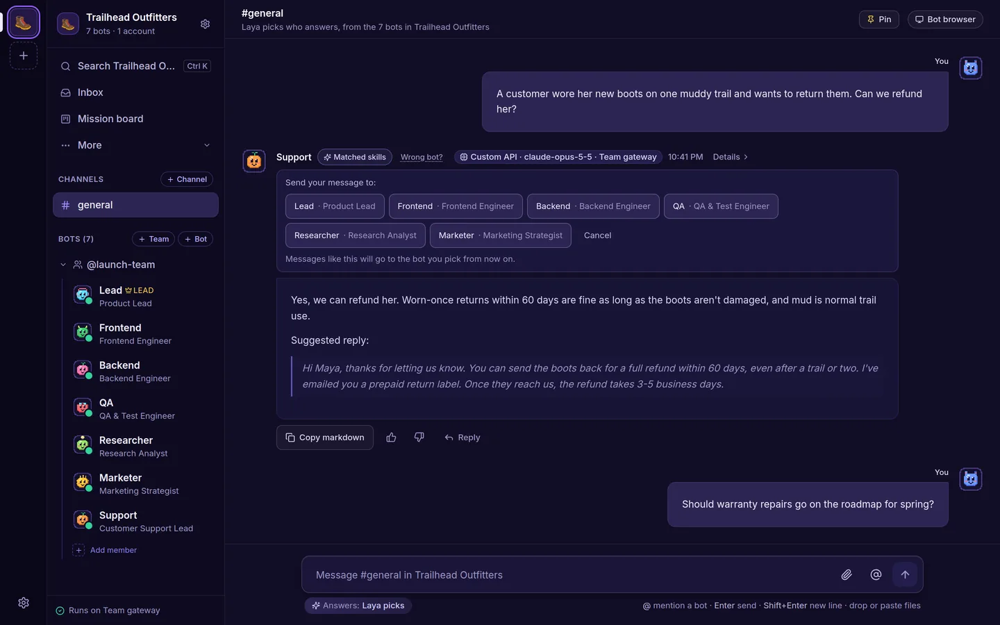<br><sub><b>Who answers</b>: the bot that fits, and why. <b>Wrong bot?</b> teaches it.</sub></td>
    <td width="50%">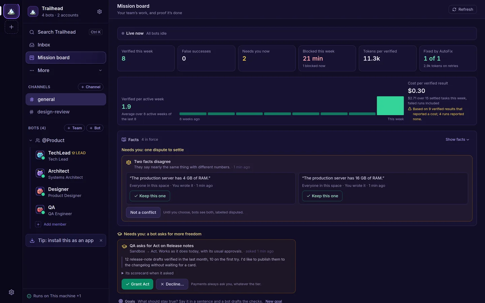<br><sub><b>Mission board</b>: verified results, their cost and what needs you (with Truth Ledger and Flight School on).</sub></td>
  </tr>
  <tr>
    <td>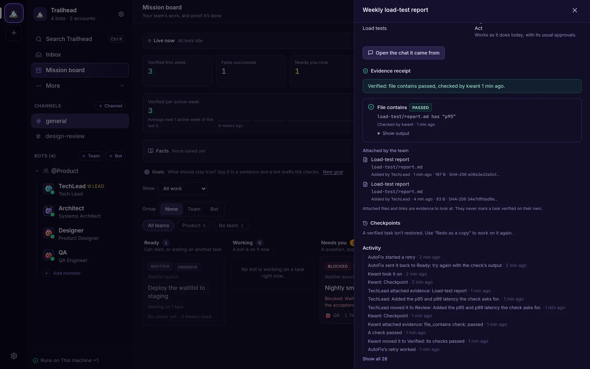<br><sub><b>Verified</b>: only when kwant runs the check, with a receipt.</sub></td>
    <td>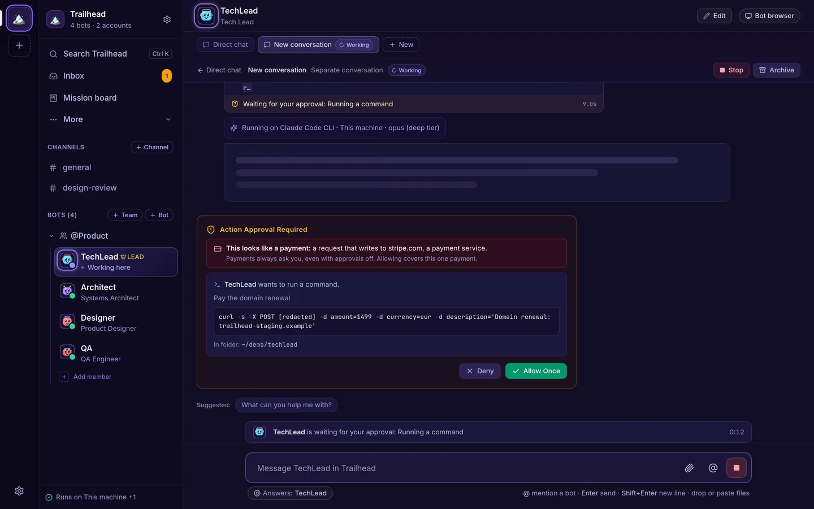<br><sub><b>Payments always ask</b>, in every approval mode.</sub></td>
  </tr>
  <tr>
    <td>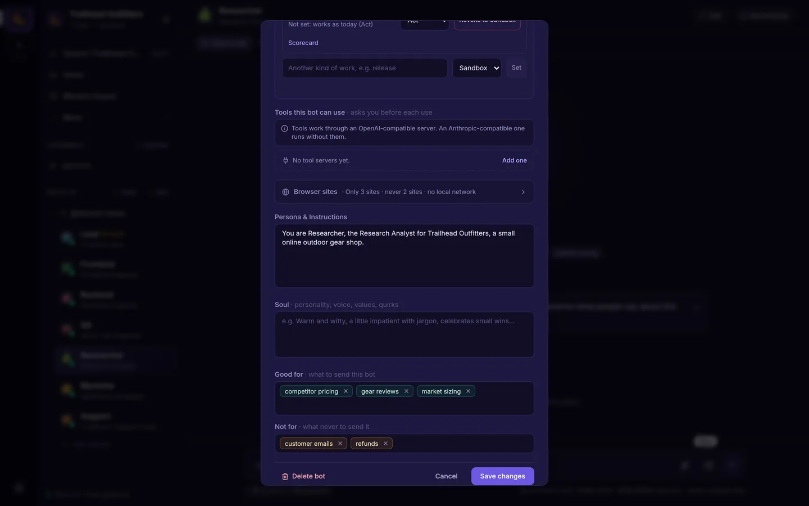<br><sub><b>Rules per bot</b>: Good for, Not for and Browser sites.</sub></td>
    <td>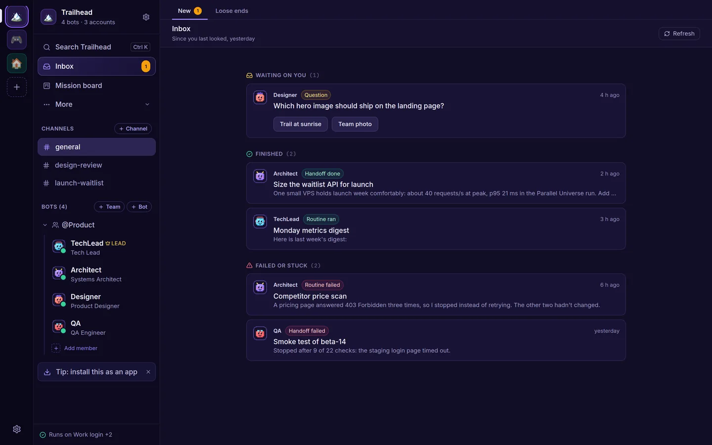<br><sub><b>Inbox</b>: what's waiting on you, what finished and what failed.</sub></td>
  </tr>
  <tr>
    <td>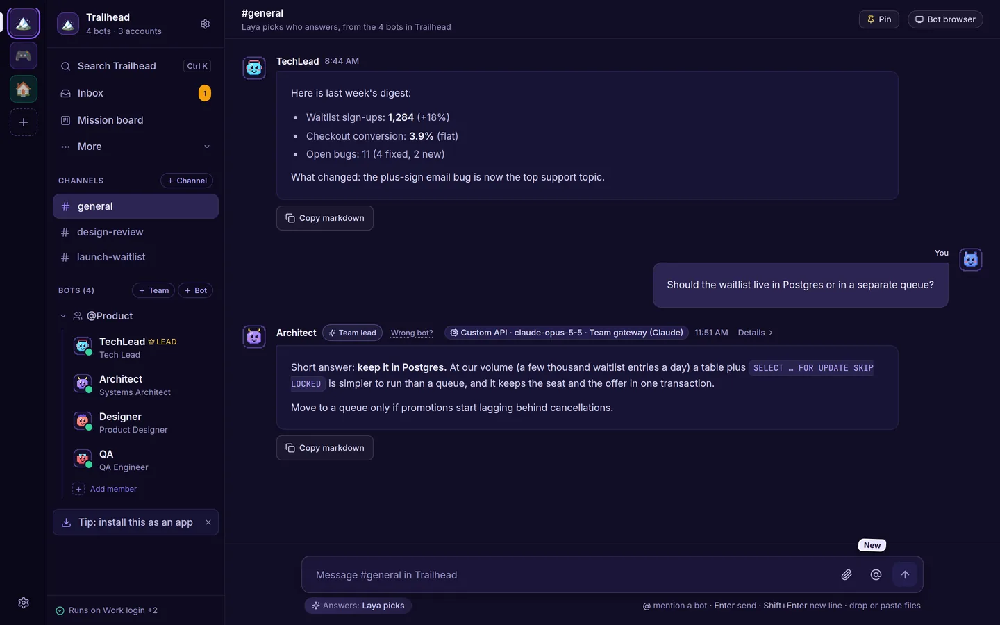<br><sub><b>Spaces</b>: each with its own bots, channels and routines.</sub></td>
    <td>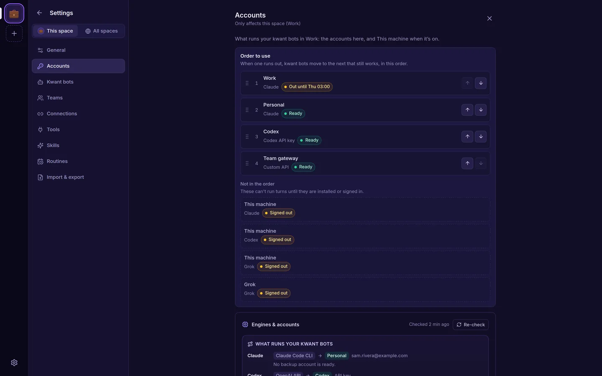<br><sub><b>Accounts</b>: several per engine, with a default and fallbacks.</sub></td>
  </tr>
  <tr>
    <td>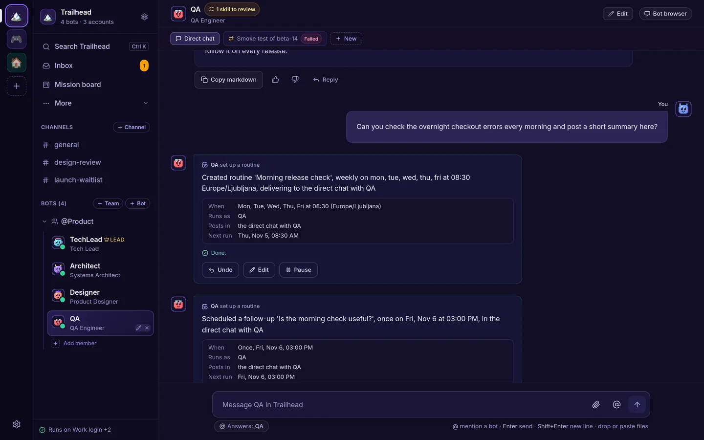<br><sub><b>Routines</b>: ask for "every morning" and get one, with Undo.</sub></td>
    <td>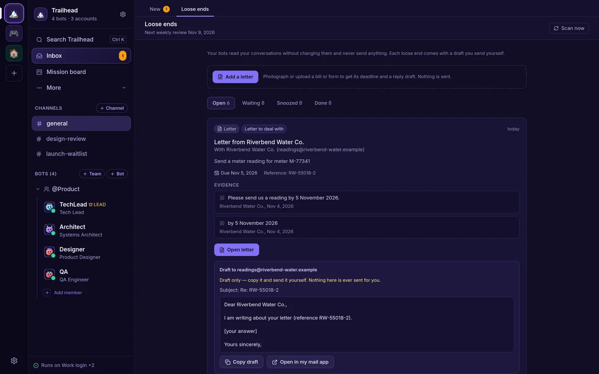<br><sub><b>Loose ends</b>, the Inbox's second tab: evidence and a draft. It never sends.</sub></td>
  </tr>
</table>

Screenshots come from a demo space with sample data.

---

## Quickstart

The quickest way is the app for Mac, Linux or Windows (beta): download it, add an AI account you already have and ask your first question. There's nothing to build. On a server, see [Self-hosting on a VPS](#self-hosting-on-a-vps).

### What you need

- **A Mac** (Apple silicon or Intel) **or a Linux x86_64 desktop** for the app.
- **At least one AI account.** Any one of these is enough:
  - a Claude, ChatGPT or Grok account. You don't need to install or sign in to anything first: the **Get started** card installs the AI when it's missing, and you sign in from the app;
  - an Anthropic, OpenAI or xAI API key, which you add in the card or under **Settings → This space → Accounts**.
- To [build from source](#run-from-a-fresh-clone) instead: **Rust** (stable), installed with [rustup](https://rustup.rs), and **Node.js 20 or newer** with npm, to build the web app. The finished binary doesn't need Node.
- Optional: **Docker** for VM mode and the bots' shared browser, and [`uv`](https://docs.astral.sh/uv/) or `python3` for the Laya router.

If you build from source, `kwnt doctor` (`cargo run -- doctor` from a clone) checks all of these and prints the install command for whatever is missing on your machine; `kwnt setup` installs it (see [Without Docker](#without-docker-kwnt-setup)).

### On a Mac: the app

[Download the Mac app](https://github.com/alexsergivan/kwant/releases/latest/download/kwant_universal.dmg) (a universal `.dmg` for Apple silicon and Intel) and drag kwant to Applications. It runs its own kwant on your Mac, with the same `~/.kwnt` data folder as `kwnt serve`, and stays in the menu bar when you close the window. Build it yourself from [`apps/mac`](apps/mac/README.md).

The app is signed ad hoc, not notarized by Apple, so macOS stops it the first time. Click **Done**, open **System Settings → Privacy & Security**, scroll down and click **Open Anyway**. On macOS 14 or earlier, right-click the app and choose **Open** instead.

### On Linux: the app (beta)

The Linux app is for x86_64. Like the Mac app, it runs its own kwant, uses the same `~/.kwnt` data folder and puts an icon in the tray.

- **Ubuntu 22.04 or newer, Debian 12 or newer:** download [`kwant_amd64.deb`](https://github.com/alexsergivan/kwant/releases/latest/download/kwant_amd64.deb), then run `sudo apt install ./kwant_amd64.deb`.
- **Other distributions:** download [`kwant_x86_64.AppImage`](https://github.com/alexsergivan/kwant/releases/latest/download/kwant_x86_64.AppImage), then `chmod +x kwant_x86_64.AppImage` and run it. It needs a normal GTK desktop and FUSE.

Updates arrive in the app, which checks each one's signature before it installs it; with the `.deb`, your system asks for your password. `sudo apt remove kwant` removes the `.deb`, and your data in `~/.kwnt` stays. It's a beta: tested in containers on Ubuntu 22.04, Ubuntu 24.04 and Debian 12, not yet on real desktops, so the tray icon, Wayland and HiDPI may vary. There's no ARM Linux app yet.

### On Windows: the app (beta)

Download `kwant_X.Y.Z_windows_x64_beta_setup.exe` from the [latest release](https://github.com/alexsergivan/kwant/releases/latest) (its SHA-256 is next to it) and run it. It's for 64-bit Windows, installs for your user only with no admin rights, and runs kwant on your PC with the same `.kwnt` data folder in your user folder as `kwnt serve`. The installer isn't code-signed yet, so the first time Windows SmartScreen warns about an unrecognized app: click **More info**, then **Run anyway**. In the beta, the app doesn't update itself (a new version is a new installer), and Grok, the VM and looking inside videos aren't available on Windows yet. In a folder OneDrive syncs with Files On-Demand, Dev mode asks before every push.

### Run from a fresh clone

```bash
git clone https://github.com/alexsergivan/kwant.git
cd kwant
make run          # builds the web app (frontend/dist), then runs `cargo run -- serve`
```

Open **http://127.0.0.1:8799**. A new person's `#general` opens with the **Get started** card: choose your AI, sign in, pick a team ([guide](https://kwant.si/docs/quickstart#get-started)). A fresh install starts with three bots in `#general`: Architect, TechLead and DevOps. Make more with **New bot**, from a ready-made persona or blank.

The binary embeds `frontend/dist`, so on a fresh clone `cargo build`, `cargo test` and `cargo run -- serve` fail to compile until you've run `make run` or `make frontend` once.

**The first start takes a few minutes:** kwant installs its Laya router and downloads its model (about 420 MB) in the background. Bots answer meanwhile, and the routing rules still pick who answers. To skip Laya, run `cargo run -- serve --no-laya`.

### Build a release binary

```bash
make build                 # web app + cargo build --release
./target/release/kwnt serve
```

### Install the web app

In Chrome or Edge, click **Install app** in **Settings → All spaces** (the sidebar also offers it once, as a tip); in Safari on a Mac, **File → Add to Dock**; on a phone, kwant shows how. Browsers only install pages served over https or from `127.0.0.1`.

To get notifications on your phone with kwant closed, install it (on an iPhone, add it to the Home Screen first) and turn on **Settings → All spaces → Notifications → Notify me on this device**. kwant then sends a Web Push notification for each kind you've ticked there, such as an approval or a question. It goes through your browser's push service (Google's for Chrome on Android, Apple's on an iPhone), encrypted so that service can't read it. Signing a browser out under **Signed-in devices** stops its notifications.

More in the [quickstart](https://kwant.si/docs/quickstart) and [install](https://kwant.si/docs/install) docs.

---

## Self-hosting on a VPS

### The binary

`kwnt` is self-contained: SQLite and the web app are inside it.

```bash
scp target/release/kwnt user@your-vps:/usr/local/bin/kwnt
ssh user@your-vps "kwnt serve --host 0.0.0.0 --port 8799"
```

On your own computer there is nothing to sign in to. From another machine, open the one-time link `kwnt serve` prints at startup (it works once, for 15 minutes; with `KWNT_ALLOWED_ORIGINS` set it is ready to open and comes with a QR code), or make a new one with `kwnt signin-link`. The browser stays signed in for a year. To add your phone or another browser later, open **Settings → Signed-in devices → Add a phone or browser** in a signed-in browser and scan the one-time QR code (it also works once, for 15 minutes); the same list lets you sign those browsers out. A new browser can also choose **Sign in from another device** on the sign-in screen: it shows a code for 10 minutes, and a signed-in browser shows **New device wants access** with Approve or Deny. Approve only a code that is on a screen you are holding. Prefer the token? On the server, as the user that runs kwnt, `cat ~/.kwnt/api-token` (or `$KWNT_DATA_DIR/api-token`, e.g. `sudo cat /var/lib/kwnt/api-token` with the systemd unit below) prints the token to paste (`kwnt token --raw` does the same; `./target/release/kwnt` if kwnt isn't on your PATH), and `kwnt token` prints a new one-time link like `kwnt signin-link`. Run them as the same user: as another user they fail, because that user can't read the token file (for the systemd unit use `sudo cat` as above). Each install has its own token, so one copied from your laptop won't open kwnt on the server. Or skip sign-in: `ssh -N -L 8799:127.0.0.1:8799 user@your-vps`, then open http://127.0.0.1:8799 on your computer (not with Docker, where requests always count as remote). A one-time link signs in as you, so keep it private until you've used it; the token never appears in the server's output. Put a TLS reverse proxy in front: see [browser service and VPS hosting](docs/browser-service.md).

<details>
<summary>A systemd unit</summary>

```ini
# /etc/systemd/system/kwnt.service
[Unit]
Description=kwant AI bot platform
After=network.target

[Service]
Type=simple
# A dedicated user (useradd --system --create-home --home-dir /var/lib/kwnt kwnt); sign the
# claude/codex/grok CLIs in as this user, or add API keys in the app
User=kwnt
ExecStart=/usr/local/bin/kwnt serve --host 0.0.0.0 --port 8799
Restart=always
Environment=KWNT_DATA_DIR=/var/lib/kwnt

[Install]
WantedBy=multi-user.target
```

```bash
systemctl daemon-reload
systemctl enable --now kwnt
```

</details>

### VPS in 5 minutes (Docker Compose)

One command starts everything kwant needs: kwnt, the **Laya** router (with its model baked in) and a private **Chromium** for the bots (VM mode), with no Docker socket mounted. You need Docker with Compose and about 4 GB of free RAM (Chromium is capped at 1.5 GB).

```bash
git clone https://github.com/alexsergivan/kwant.git && cd kwant
KWNT_CLIS=claude,codex docker compose up -d --build   # any of claude,codex,grok; leave out for none
docker compose exec kwnt kwnt doctor                  # what works, and the fix for what doesn't
docker compose exec kwnt claude auth login            # sign a CLI in (codex login --device-auth, grok login --device-auth)
docker compose exec kwnt kwnt signin-link            # a one-time sign-in link and QR code (15 minutes)
```

Or skip the CLIs and add an Anthropic, OpenAI or xAI API key in the app under **Settings → This space → Accounts**. CLI sign-ins live in the `kwnt-home` volume and data in `kwnt-data`, so both survive rebuilds.

**HTTPS:** the UI is published on `127.0.0.1:8799` only. Put a TLS proxy in front, e.g. [Caddy](https://caddyserver.com) with this `Caddyfile`, and tell kwnt its address:

```
kwant.example.com {
	reverse_proxy 127.0.0.1:8799
}
```

```bash
echo KWNT_ALLOWED_ORIGINS=https://kwant.example.com >> .env && docker compose up -d
```

`docker compose exec kwnt kwnt signin-link` prints a one-time sign-in link for your domain and a QR code to scan with your phone. It works once, for 15 minutes; run it again for the next device. `docker compose exec kwnt kwnt token --raw` still prints the API token, as a fallback.

- **Image sizes** (measured): kwnt alone 0.2 GB; with `KWNT_CLIS=claude,codex,grok` 1.7 GB (the CLIs add about 0.9 GB, so they are off by default). Laya 3.2 GB, the browser 1.2 GB. Idle RAM: Laya about 1.7–2.3 GB, the browser about 0.4 GB, kwnt about 25 MB.
- **kwant's own `execute_shell` tool** runs in per-team Docker containers, so it isn't available inside this stack: that would need the host's Docker socket, which is root on the host. The CLIs' own shell tools work inside the kwnt container.
- **Upgrading from an older image:** kwnt now runs as uid 10001, not root. If it says `/data isn't writable`, run once: `docker compose run --rm -u root kwnt chown -R 10001:10001 /data`.

### Without Docker: `kwnt setup`

`kwnt setup` installs what kwant needs on this machine: Chromium or Chrome for the bots' browser, Laya (in kwant's data folder, with its own `uv` if you have no Python), and a CLI (`claude` unless you name others with `--clis`). It asks before each step (`--yes` skips the questions), never runs `sudo` itself (it prints the command for you instead), installs into your home folder where it can, skips Docker unless you pass `--docker`, and running it again changes nothing. `--dry-run` shows the plan. The app has the same checklist under **Setup**.

One line per platform, each followed by `kwnt doctor`:

| Platform | Install | Then |
|---|---|---|
| Mac app | Download the `.dmg` from [Releases](https://github.com/alexsergivan/kwant/releases) and open it | Run `kwnt doctor` |
| Linux app (beta, x86_64) | Download the `.deb` or the AppImage from [Releases](https://github.com/alexsergivan/kwant/releases) and [install it](#on-linux-the-app-beta) | Open **Setup** in the app |
| Mac, command line | `git clone https://github.com/alexsergivan/kwant.git && cd kwant && make build && ./target/release/kwnt setup` (uses Homebrew when you have it) | Run `kwnt doctor` |
| Linux desktop or server | The same clone and `make build`, then `kwnt setup`, or `sh scripts/install-linux-deps.sh --clis claude` on Debian/Ubuntu | Run `kwnt doctor` |
| VPS with Docker | [Docker Compose](#vps-in-5-minutes-docker-compose) | Run `docker compose exec kwnt kwnt doctor` |

There's no prebuilt `kwnt` binary or Homebrew formula yet, so the command line needs a clone and a build (Rust and Node).

---

## Laya model router

[Laya](https://huggingface.co/convaiinnovations/laya) picks which model and effort a bot uses when its model is `auto`. When kwant picks which bot answers in a channel, Laya adds its own guess from the bots' titles, but it never picks a bot on its own: kwant's [routing rules](docs/channel-routing.md) do. It runs as a small Python service, and **`kwnt serve` manages it for you**: on first run it installs `laya[serve]` into `~/.kwnt/laya/venv` (with `uv` when present, else `python3 -m venv`), starts it, and restarts it if it exits. The header shows its status. While Laya is unavailable, the rules still pick the bot, the model and effort come from a keyword estimate, and the reason line under a reply says it was a keyword match.

| Setting | `config.toml` | Environment | Default |
|---|---|---|---|
| Laya URL | `laya_url` | `LAYA_URL` | `http://127.0.0.1:8000` |
| Manage a local Laya | `laya_managed` | `KWNT_LAYA_MANAGED=0` to disable, or `kwnt serve --no-laya` | `true` |
| Checkpoints to preload | `laya_models` | `KWNT_LAYA_MODELS` | `english` |
| Use an existing `laya-serve` binary | | `KWNT_LAYA_SERVE_BIN` | |

The first start needs `huggingface.co`. Behind a proxy that blocks it, start kwant once on an open network or copy `~/.kwnt/laya/hf` from another machine.

---

## FAQ

**Is kwant free?** Yes. It's open source under the AGPL-3.0: use it, change it and run it for yourself, your team or your company, at any size. You pay only for the AI accounts you already have. If you want to sell or host kwant without publishing your changes, there's a [commercial license](COMMERCIAL.md).

**Can I use my Claude or ChatGPT plan?** Yes. kwant runs the Claude, Codex or Grok CLI you're signed in to, so your plan covers the work. You can also add Anthropic, OpenAI or xAI API keys, or your own OpenAI- or Anthropic-compatible server. When one account runs out of usage, the turn moves to the next.

**How is it different from Grok Bot, Claude Duet or OpenAI dots?** It's the same idea, a team of named bots you message, but open source, running on your own computer or server, with any of your accounts. And a task counts as done only when kwant runs the check itself. Side by side: [kwant vs Grok Bot](https://kwant.si/alternatives/grok-bot).

**Where does my data go?** It stays on your computer or server, in kwant's data folder (`~/.kwnt` by default). kwant has no telemetry and sends nothing to us. Your messages go only to the AI providers and services you add.

**Do I need an account with you?** No. There's no sign-up: you run kwant yourself and sign in only to the AI accounts you add.

**Which computers can run it?** A Mac (Apple silicon or Intel), a Linux desktop (x86_64, beta), a Windows PC (64-bit, beta) or a Linux server, with the binary or Docker Compose.

**Can I run it on a free server?** Yes. [This guide](https://kwant.si/blog/self-host-grok-bot-alternative-free-oracle-cloud) sets kwant up on Oracle Cloud's free tier, step by step.

---

## Documentation

- What changed in each release: [CHANGELOG.md](CHANGELOG.md)
- Website docs: [kwant.si/docs](https://kwant.si/docs/quickstart): quickstart, install, spaces, bots and teams, Mission board, Flight School, Truth Ledger, models and routing, accounts, routines, approvals, the bots' browser, loose ends, Parallel Universe, memory and skills, MCP.
- In this repo:
  - [Channel routing: who answers](docs/channel-routing.md)
  - [Mission Control and verified outcomes](docs/mission-control.md)
  - [Approvals](docs/approvals.md)
  - [Payments always ask](docs/payments.md)
  - [How bots use their browser](docs/bot-browser.md)
  - [Bot actions](docs/bot-actions.md)
  - [Browser service and VPS hosting](docs/browser-service.md)
  - [LLM profiles (accounts) and API access](docs/llm-profiles.md)
  - [Connections API](docs/connections.md)
  - [Live activity and human steps API](docs/live-activity.md)
  - [MCP API](docs/mcp-api.md)
  - [Saved passwords](docs/saved-passwords.md)
  - [Loose ends (zombie hunter)](docs/zombie-hunter.md)
  - [Letters (camera to completed)](docs/camera-to-completed.md)
  - [Parallel Universe](docs/parallel-universe.md)
  - [Dev mode](docs/dev-mode.md)
  - [Idea jar](docs/idea-jar.md)

---

## Contributing

Bug reports, ideas and pull requests are welcome. Read [CONTRIBUTING.md](CONTRIBUTING.md) for how to build, test and send a change, and follow the [Code of Conduct](CODE_OF_CONDUCT.md).

```bash
make frontend                  # build the web app once (cargo test needs frontend/dist)
cargo test                     # Rust unit and integration tests
cd frontend && npm test        # web app tests
```

## Security

kwant runs commands and holds API keys and passwords, so please report vulnerabilities privately. See [SECURITY.md](SECURITY.md). Don't open a public issue for a security problem.

## Contact

- Email: [contact@kwant.si](mailto:contact@kwant.si), for questions, a commercial license, privacy requests or press.
- Bugs and ideas: [GitHub issues](https://github.com/alexsergivan/kwant/issues). Questions and setups to share: [GitHub Discussions](https://github.com/alexsergivan/kwant/discussions).
- Security problems: report them privately, as [SECURITY.md](SECURITY.md) describes.

## License

kwant is open source under the [GNU Affero General Public License v3.0](LICENSE) (AGPL-3.0-only).

- **Free for everyone:** use it, change it and run it for yourself, your team or your company, at any size.
- **Share your changes if you serve them:** if you change kwant and let others use it over a network, for example as a hosted service, you must publish your changed source code under the AGPL too.
- **Commercial license:** if you want to sell kwant, host it or build it into your product without publishing your changes, you can buy a commercial license instead. See [COMMERCIAL.md](COMMERCIAL.md).

Code published before the switch, including the mac-v0.1.0 release, stays under MIT OR Apache-2.0.

Contributions are accepted under the terms in [CONTRIBUTING.md](CONTRIBUTING.md#license).
